# Pool of Radiance

This project is a source reconstruction and expanded edition of SSI's DOS version of *Pool of Radiance*. It began as a byte-for-byte reconstruction of versions 1.1, 1.2 and 1.3, then grew into a maintained version of the game with bug fixes, new tools, new features and native-platform work.

## Read this first

- This source was reverse-engineered directly from the original game executables. It is **not** a clean-room reimplementation of the game, its engine or its mechanics.
- *Pool of Radiance*, *Forgotten Realms*, *Dungeons & Dragons*, Strategic Simulations, Inc. and all related names, trademarks, copyrights, artwork, writing, game data and other rights belong to their respective owners. I do not claim ownership of them. This project is not affiliated with or endorsed by those owners.
- The only game executables and data files included in project releases are ones I compiled or generated from this source. SSI's original retail game data is not included. You need to own a copy of *Pool of Radiance* to play. It is sold as part of *Forgotten Realms: The Archives — Collection Two* on [GOG](https://www.gog.com/en/game/forgotten_realms_the_archives_collection_two) and [Steam](https://store.steampowered.com/app/1904580/Forgotten_Realms_The_Archives__Collection_Two/).
- AI coding tools were used throughout the project: Anthropic's Claude Code, OpenAI Codex, and the Pi coding agent with Qwen3-Next-Coder.
- This is a hobby and preservation project. It is provided as-is, without warranty, customer service or a promise that it will work on your system. Back up your game and saved characters before replacing anything. Please do not ask GOG, Steam, SNEG or the original rights holders for support with this project; see [Questions and bug reports](#questions-and-bug-reports).
- Because the reconstructed game code and the project's new code are interwoven, this repository does not make a blanket open-source license grant. Making the source visible does not grant rights to the original game or its derived material. Anyone reusing or redistributing material from this repository is responsible for determining what they may legally use.

Laws concerning reverse engineering and derived works vary. You are responsible for complying with the laws and terms that apply to your copy of the game.

## What this project does

The historical `v1.1`, `v1.2` and `v1.3` tags reconstruct their corresponding DOS releases byte for byte. Current development builds on version 1.3—the version distributed by GOG and Steam—and deliberately changes it.

The goal is to keep the original game recognizable while fixing long-standing bugs and adding useful features that fit a Gold Box game. Existing SSI-format saved games and character files remain supported.

## Highlights

- **Companion Tools.** A full 16×16 automap shows explored ground, walls, doors, events and Clue Book locations. You can attach notes to map squares and use an in-game character editor for abilities, levels, experience, health, inventory, money and spells.
- **Bestiary and sage.** The Bestiary records creatures the party has met and gradually fills in what you learn about their armor class, hit dice, defenses, attacks and other traits. New Phlan's fortune teller can complete an entry for a fee.
- **Spell and item information.** Spell lists show range, area, duration, saving throw and casting restrictions. A full information page explains each spell as it works in this game. Wands, potions, scrolls and other spell-casting items use the same system.
- **Better combat previews.** Area spells show how many enemies and allies the chosen placement will catch. Lightning bolts and the Javelin of Lightning preview their full path. A combat log records attacks, damage, spells, effects and other events.
- **Character and game statistics.** Each character keeps kill counts, damage, healing, spells cast, loot and other statistics. More Info also includes detailed thief skills and a cleric's actual Turn Undead table.
- **More character choices.** Paladins and rangers can be created, including half-elf cleric/rangers, and eligible humans can dual-class at a training hall.
- **Modernized saving and setup.** The game has a full-screen save/load menu with descriptions and timestamps, quick save and quick load, a persistent vault in New Phlan, a setup program and much more control over video, sound and gameplay settings.
- **A more capable combat AI.** Creatures can route around walls, bodies and dead ends instead of getting stuck walking back and forth. Quick Mode characters can bandage fallen allies and make better use of their turns.
- **Expanded presentation.** VGA video, AdLib music, Sound Blaster effects and native digital audio join the original CGA, EGA, Tandy and speaker options.
- **New and restored content.** The Journal tracks active quests, parts of New Phlan change as the city is reclaimed, Dirten can restore the Temple of Bane, and the sage has a home and a purpose.
- **A large body of fixes.** Combat rules, spells, items, character progression, saving, menus, data errors, crashes and many SSI-era edge cases have been corrected.

See [the changelog](docs/changelog.md) for the player-facing list and [the detailed changes](docs/detailed-changes.md) for the full technical record.

## Playing the DOS Version

1. Buy and install *Pool of Radiance* from [GOG](https://www.gog.com/en/game/forgotten_realms_the_archives_collection_two) or [Steam](https://store.steampowered.com/app/1904580/Forgotten_Realms_The_Archives__Collection_Two/).
2. Back up the game's `START.EXE` and `GAME.OVR` files, along with your saves and characters.
3. Copy this project's `START.EXE`, `GAME.OVR` and `POOLCFG.EXE` into the game directory.
4. Run `POOLCFG.EXE` to choose the video mode, sound device, introduction, game settings, and data and save directories. If `POOL.CFG` is missing, `START.EXE` will run the setup program before starting the game.

On its first start, the game builds combined archives from your legally obtained game data. This allows the project to patch scripts and other data without distributing the original files. The originals are only read. The build normally happens once and writes its progress to `DATABLD.LOG`; if the combined files cannot be created, the game can still run, but data fixes will not be active.

Installation should be similar for macOS and Linux users: drop the files into the appropriate directory and start the game normally.

This version needs a faster computer than SSI's did. DOSBox's default speed (`cycles=auto`, which runs DOS games at 3,000 cycles) is too slow for it: the game measures the speed when it starts and, when the computer is too slow, says so before the main menu. In DOSBox, raise the CPU cycles: `cycles=max`, or for example `cycles=fixed 20000`. GOG's DOSBox settings for the game (`cycles=fixed 30000`) are fast enough.

## Questions and bug reports

This is a modified version of the game. GOG, Steam and SNEG can't help with it. Please send questions and bug reports to talonius@brazencrows.com. The game says so too, on its first start after each new version and on the System page of the Settings screen.

## Building From Source

See [docs/COMPILING.md](docs/COMPILING.md) for the compilers, tools and commands needed to build the DOS and native versions.

## Credits and Thanks

This work would not exist without SSI's original game and the people who have spent years documenting and exploring the Gold Box engine.

Special thanks to:

- [Gold Box Companion](https://gbc.zorbus.net/) for its character tools, automapping and years of practical Gold Box knowledge.
- [Gold Box Explorer](https://github.com/bsimser/Gold-Box-Explorer) for making the games' files and resources much easier to inspect and understand.
- Simeon Pilgrim's [CoAB project](https://github.com/simeonpilgrim/coab), an earlier reverse-engineering effort for *Curse of the Azure Bonds* that provided valuable reference work.
- Stephen S. Lee for the thorough [Pool of Radiance FAQ](https://gamefaqs.gamespot.com/pc/564785-pool-of-radiance/faqs/73869).
- GOG and Steam for continuing to sell these games and giving new players a way to find them.
- SNEG for handling the rights work and negotiations that allowed the Gold Box games to return to sale.

Thanks as well to everyone who has tested the game, reported a strange old bug, compared a rule against the manuals, or kept a save file around long enough to prove something was wrong.

## Screenshots

A selection of the changes this project has made to the game.

**Aiming fireball.**

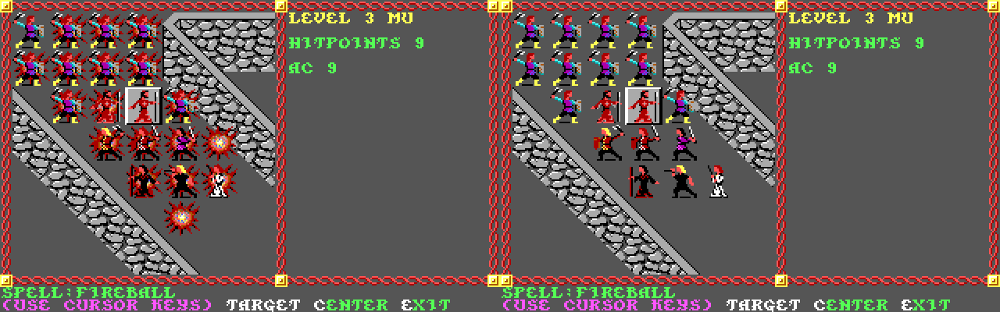

**Aiming lightning bolt.**

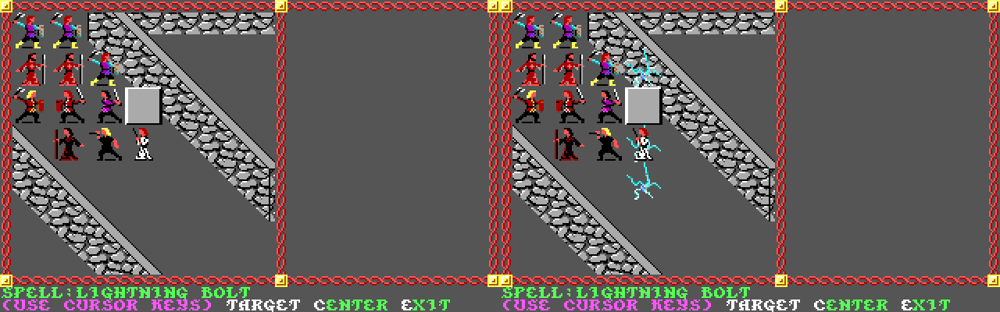

**Aiming stinking cloud.**

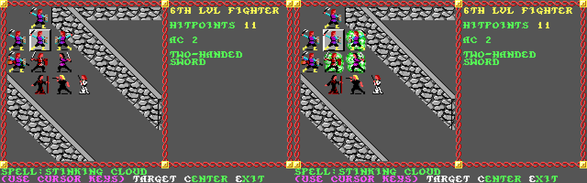

**Aligned weapon damage.**

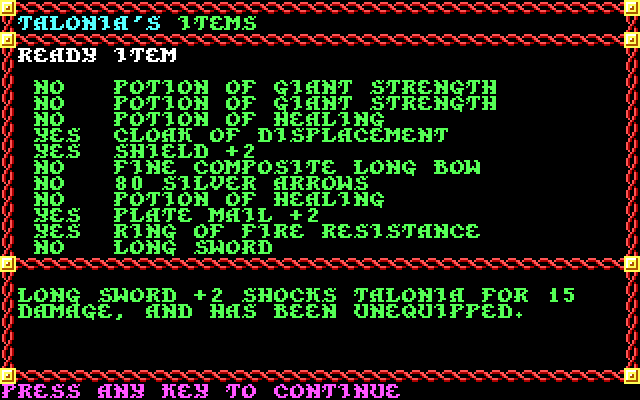

**Bestiary.**

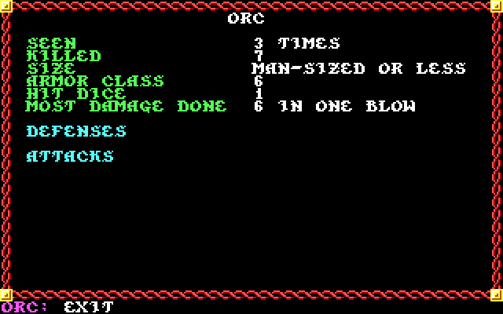

**Cast includes usable scrolls.**

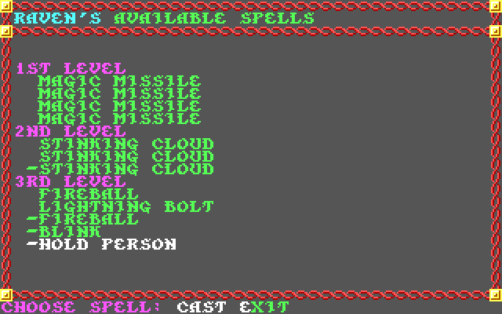

**In game character editor.**

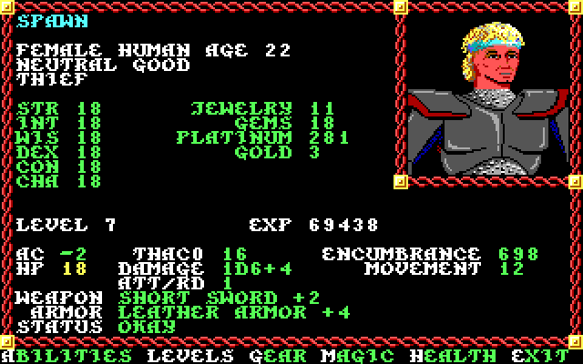

**New combat icon editor.**

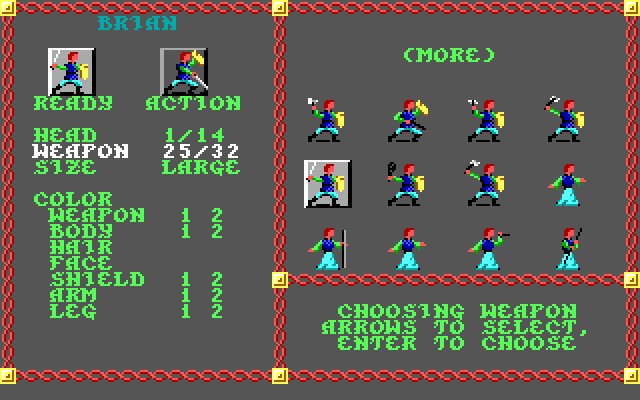

**In game area map.**

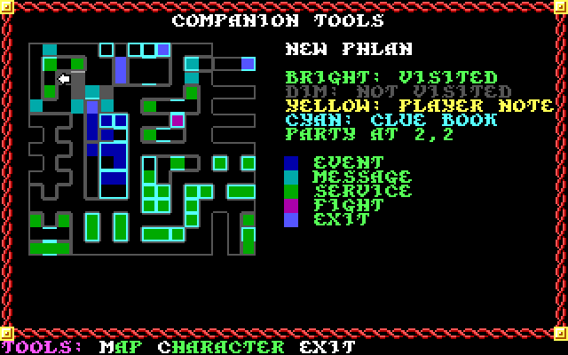

**Damaged character file notice.**

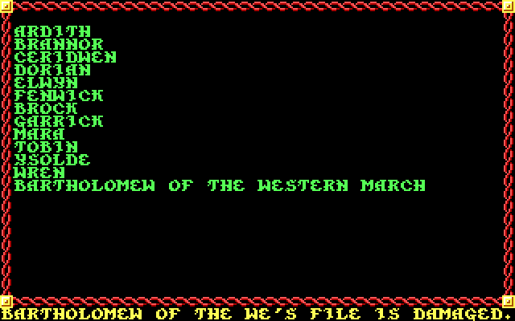

**Data Builder UI.**

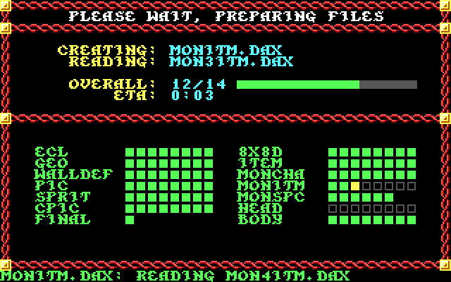

**Dual class UI.**

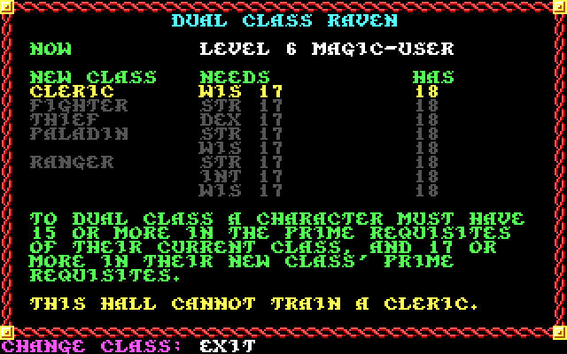

**Camp has the Fix option.**

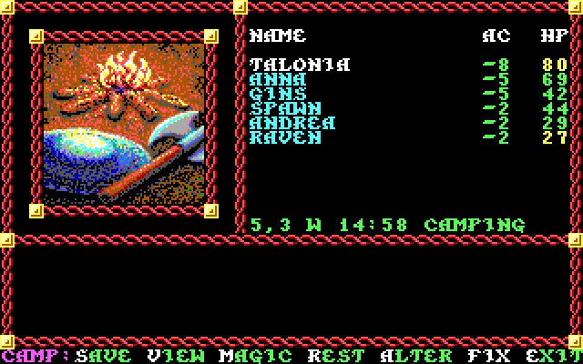

**Improved appraise interface.**

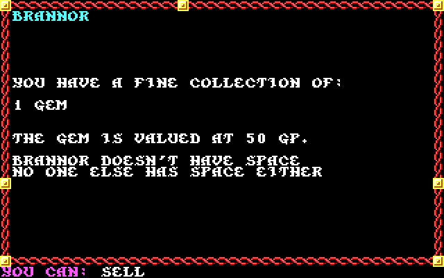

**In game journal.**

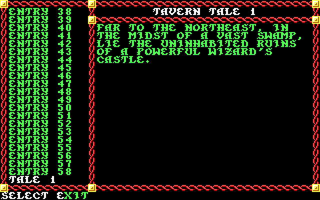

**Characters ready to level are shown in magenta.**

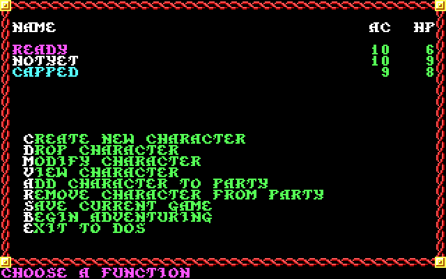

**New memorize UI includes basic spell info.**

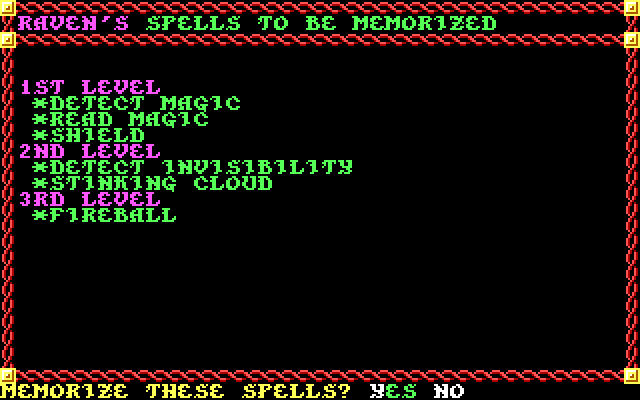

**New Load/Save game UI.**

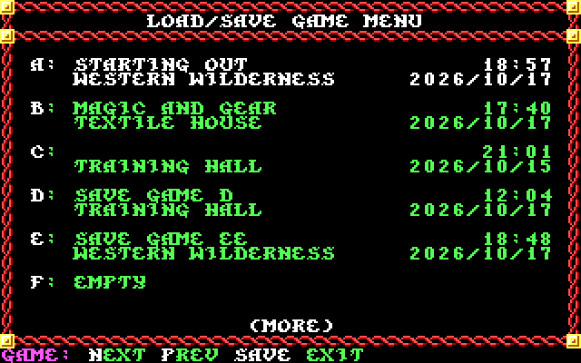

**Paladins can Heal and Cure.**

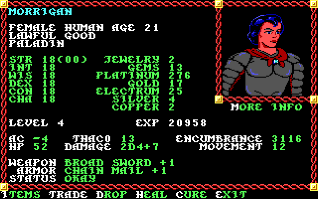

**New portrait picker UI.**

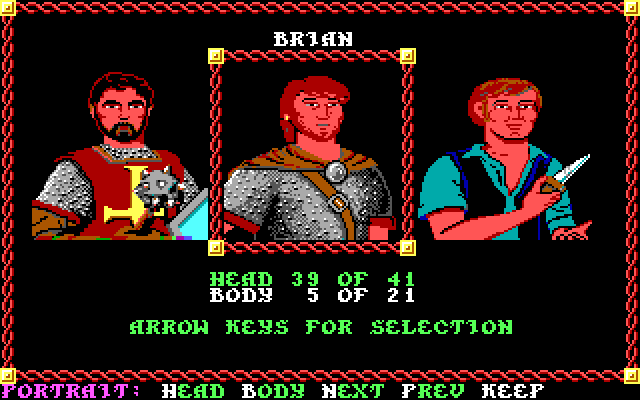

**Quest tracker in game, accessible via the Journal.**

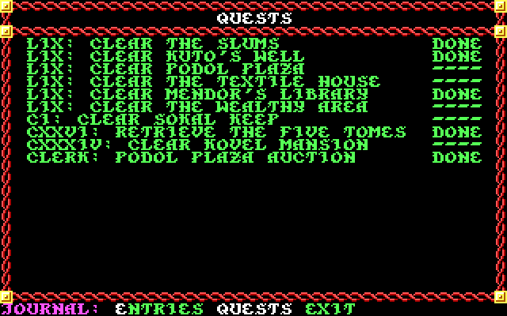

**Quick combat indicators include how to stop it, and whether magic is enabled.**

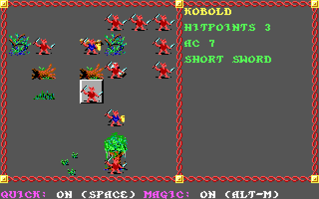

**Racial ability score modifiers and class limits are shown during selection.**

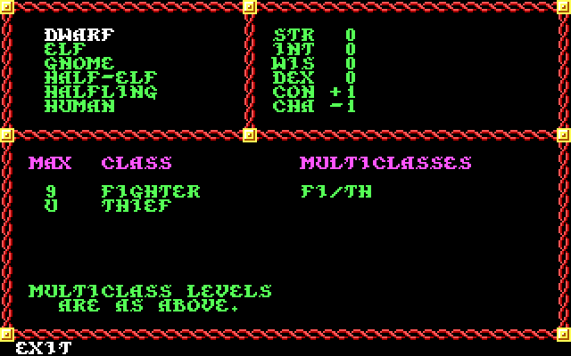

**Saving throws are now viewable.**

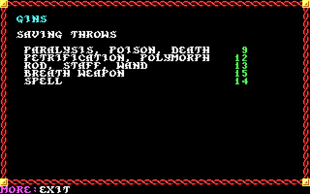

**New Scribe UI.**

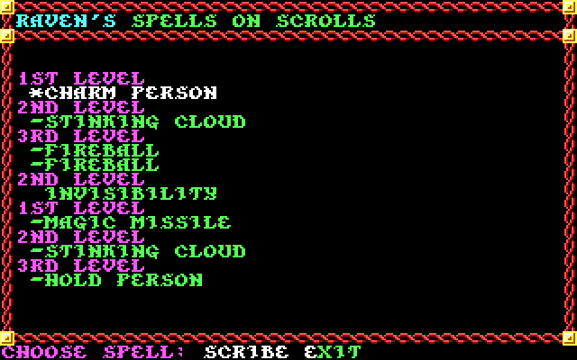

**Settings screen gives players control.**

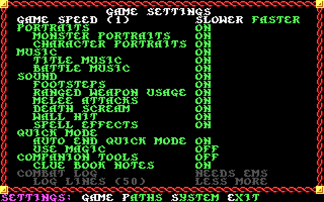

**Spell descriptions and information are accessible from in game.**

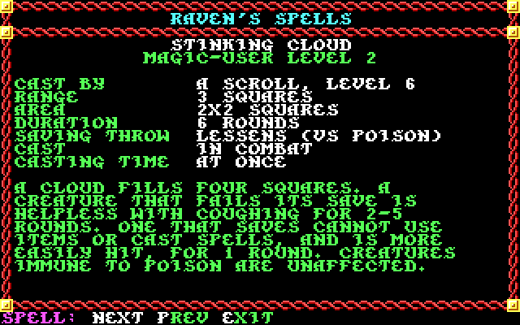

**Game statistics.**

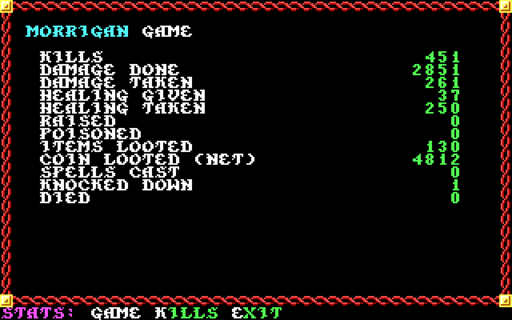

**More game statistics.**

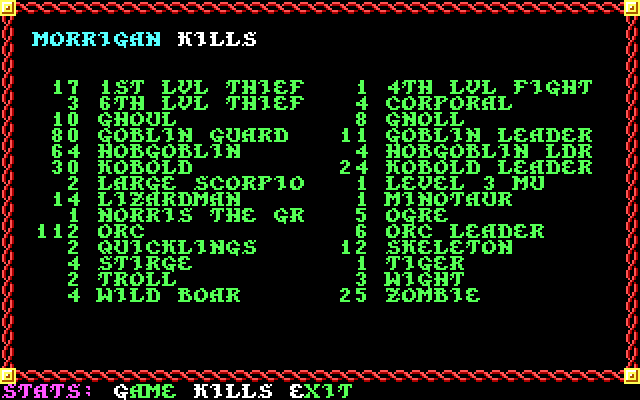

**The Turn Undead table is visible for clerics and paladins.**

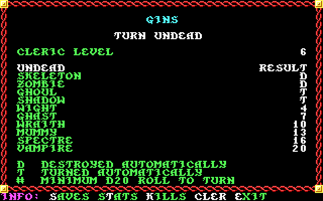

**A Vault has been added to New Phlan.**

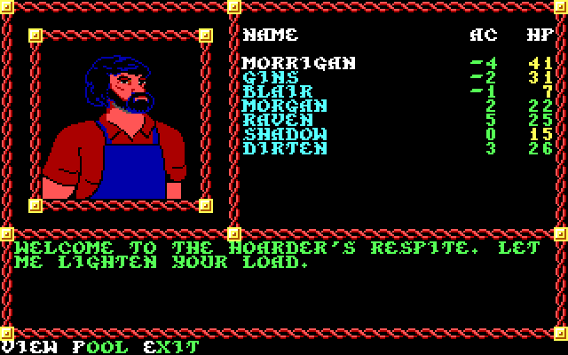
